# End-to-End Full LLM Lifecycle Eshkol AOT Suite

This document describes the standalone compiled **End-to-End Full LLM Lifecycle Eshkol AOT Suite**, which composes all nine integrated Wave 4/5 native C11 subsystems into a single statically linked, deterministic compiled Eshkol AOT executable (`test_e2e_llm_lifecycle`) executing across five distinct OS process boundaries.

## Linked Native Subsystems & Archives

All runtime execution is Eshkol-native + C11 (zero Python in the runtime path; zero dynamic project `.so` dependencies in the compiled AOT ELF):

| Stage | Subsystem | Header | Static Archive |
| :--- | :--- | :--- | :--- |
| 1 | DATA4 Corpus Hygiene & Near-Dedup | `include/eshkol_transformer/data4_pipeline_abi.h` | `libeshkol_transformer_data4_pipeline.a` |
| 2 | T2 Deterministic BPE Trainer | `include/eshkol_transformer/t2_bpe_trainer_abi.h` | `libeshkol_transformer_t2_trainer.a` |
| 3 | MOD5 RoPE + K1 ABI | `include/eshkol_transformer/mod5_rope_abi.h` | `libeshkol_transformer_mod5_rope.a`, `libeshkol_transformer_k1.a` |
| 3 | MOD5 AdamW + D1 `.ets` + `ETM5TRN1` | `include/eshkol_transformer/mod5_adamw_abi.h` | `libeshkol_transformer_mod5_adamw.a` |
| 4 | LoRA Adapter Fine-Tuning (`ETLR1000`) | `include/eshkol_transformer/lora_adapter_abi.h` | `libeshkol_transformer_lora.a` |
| 5 | DPO Preference Alignment | `include/eshkol_transformer/dpo_alignment_abi.h` | `libeshkol_transformer_dpo.a` |
| 6 | EVAL5 Contamination-Gated Benchmark | `include/eshkol_transformer/eval5_benchmark_abi.h` | `libeshkol_eval5.a` |
| 7 | Exact Lossless Speculative Decoding | `include/eshkol_transformer/spec_decode_abi.h` | `libeshkol_transformer_spec_decode.a` |
| 8 | Native IO5 `F16`/`BF16`/`Q8_0` Codecs | `include/eshkol_transformer/io5_quant_abi.h` | `libeshkol_transformer_io5_quant.a` |
| 1–8 | E2E Lifecycle Orchestration Bridge | `include/eshkol_transformer/e2e_lifecycle_abi.h`, `native/e2e_lifecycle_eshkol_bridge.h` | `libeshkol_transformer_e2e_lifecycle.a` |

## Stage-by-Stage Dataflow & Multi-Process Boundaries

```mermaid
flowchart TD
    P1["Process 1: --phase stage1-2"]
    S1["Stage 1: DATA4 Corpus Hygiene & Near-Dedup\n11 raw docs -> 6 kept, 5 dropped\n(exact, near, utf8, length, quality)"]
    S2A["Stage 2a: T2 BPE Train & Atomic Save\nETBPE100 v1.0 (vocab=360, 102 merges)"]

    P2["Process 2: --phase stage2-3a (Fresh OS Process)"]
    S2B["Stage 2b: T2 Fresh Reload + Lossless Decode\n2.12x compression -> D1 v1.0 .ets shard (766 tokens)"]
    S3A["Stage 3a: MOD5 RoPE + AdamW Pretraining\nUninterrupted 8-step ref (stage3_full.etsnap)\nSplit Part 1 steps 1..4 (stage3_mid.etsnap)"]

    P3["Process 3: --phase stage3b-4a (Fresh OS Process)"]
    S3B["Stage 3b: Fresh Snapshot Resume & Parity\nCorrupt snapshot rejected (-5) -> steps 5..8\nBitwise weight & SHA-256 parity vs 8-step ref"]
    S4A["Stage 4a: LoRA Fine-Tuning (rank=4 on W_ff1)\n10 steps, frozen base SHA-256 invariance,\nmerge/unmerge <= 1e-6 -> ETLR1000 save"]

    P4["Process 4: --phase stage4b-8 (Fresh OS Process)"]
    S4B["Stage 4b: Fresh LoRA Reload & Merge\nWrong-base-hash rejected (-11) -> merge into W_ff1"]
    S5["Stage 5: DPO Preference Alignment\n12 steps (beta=0.25), masked prompt +0.0f grad,\nloss down, margin up, acc=1.0, frozen ref SHA-256"]
    S6A["Stage 6a: EVAL5 Contamination Gate & Scoring\nContaminated eval rejected (-7, zero manifest written)\nClean held-out -> LM NLL/PPL + MC acc -> atomic manifest"]
    S7["Stage 7: Lossless Speculative Decoding\nStage 3 base draft vs Stage 5 aligned target\nGreedy 100% match + seeded stochastic replay + EOS stop"]
    S8["Stage 8: Native IO5 Quantization Round-Trip\n13,568 trained weights -> F16 / BF16 / Q8_0\nBounded finite reconstruction error"]

    P5["Process 5: --phase stage6-verify (Fresh OS Process)"]
    S6B["Stage 6b: Fresh-Process EVAL5 Manifest Reload\nSHA-256 & metric parity verified"]

    P1 --> S1 --> S2A
    S2A -. "stage1_clean_corpus.bin + stage2_tokenizer.etbpe" .-> P2
    P2 --> S2B --> S3A
    S3A -. "stage3_train.ets + stage3_mid.etsnap + stage3_full.etsnap" .-> P3
    P3 --> S3B --> S4A
    S4A -. "stage3_resumed.etsnap + stage4_lora.etlr" .-> P4
    P4 --> S4B --> S5 --> S6A --> S7 --> S8
    S6A -. "stage6_clean.manifest (SHA-256)" .-> P5
    P5 --> S6B
```



## Stage 3 Model Tensor-Shape Contract & Gradient Verification

Stage 3 executes a single-block rotary transformer language model in binary32 (`f32`) with binary64 (`f64`) loss/softmax accumulation:

- `D = 16`, `H = 2`, `Dh = 8` (valid for `et_mod5_rope_forward_f32` / `et_mod5_rope_backward_f32`), `D_ff = 32`, `T = 8`, `V = V_bpe` (`360`).
- Flat parameter layout:
  - `W_emb [V, 16]`, `W_q [16, 16]`, `W_k [16, 16]`, `W_v [16, 16]`, `W_o [16, 16]`, `W_ff1 [32, 16]`, `W_ff2 [16, 32]`, `W_lm [V, 16]`.
  - Total parameters: `32 * V + 2048 = 13,568` (guaranteed divisible by `32` for `ET_IO5_QK8_0` block alignment for every `V`).
- Numerical central finite-difference gradient check (`et_e2e_stage3_check_fd_gradients`, 16 probes across all 8 parameter tensors):
  - Measured `max_abs_err = 4.37665327e-07` (threshold `<= 2.0e-3`).

## Measured Verification Evidence (Pinned Container `eshkol-r0-debug:20260928`)

Measured under `CC=clang-21`, `CXX=clang++-21`, `ESHKOL_SOURCE_DIR=/tc/src`, `ESHKOL_BUILD_DIR=/tc/build`:

- **Deterministic Bridge Archive** (`libeshkol_transformer_e2e_lifecycle.a`, normal `-O2`):
  - SHA-256: `73154fd3a9353e2d6835336329689fcc1695141e365cd024fd61edb5f628f343`
- **Dual Fresh Byte-Identical Eshkol AOT ELF** (`test_e2e_llm_lifecycle`, `--strict-types --optimize 0 --no-stdlib`, zero dynamic `libeshkol_transformer_*.so` dependencies):
  - SHA-256: `d555e2a6d11f57f82b77cff42ee045d6130932bea25bd70f3bbd3b261498d31d`
- **Multi-Process Stdout Parity**: Two independent 5-process runs from the two fresh ELFs produced byte-identical stdout (`cmp` exit 0) and zero stderr.
- **Sanitizers**: Native C11 + C++17 suites passed under `-fsanitize=address,undefined` with `ASAN_OPTIONS=detect_leaks=1:halt_on_error=1` and `UBSAN_OPTIONS=halt_on_error=1:print_stacktrace=1`.

| Stage | Key Measured Metrics | Artifact / Integrity SHA-256 |
| :--- | :--- | :--- |
| 1. DATA4 | `input=11`, `kept=6`, `exact_dup=1`, `near_dup=1`, `bad_utf8=1`, `bad_len=1`, `bad_qual=1`, `kept_bytes=1611` | Report: `08deb54c4043ebec90f911cc1ff5954551157ac9e911be40ec821553e57def0c` |
| 2. T2 BPE | `vocab=360` (`merges=102`, `bos=358`, `eos=359`), `raw_bytes=1611`, `encoded_tokens=760`, `compression=2.1197x`, `lossless=1`, `shard_tokens=766` | `ETBPE100`: `4f2bf6a0d1d0e49723001da69d214a5db0a3e80653bee474570518cc94766db8` |
| 3. MOD5 + RoPE + AdamW | `params=13568`, `loss1=5.888232 -> loss4=5.120744 -> loss8=2.669254`, `weights_bitwise_equal=1`, `snapshot_sha_equal=1`, `corrupt_rejected=1` | `ETM5TRN1` (full == resumed): `471690835862b0e314373690d8bf0f7817a5966cf35eb4af7d08cd4da546e1a2` |
| 4. LoRA (`rank=4`) | `steps=10`, `loss0=0.012462 -> lossf=0.012360`, `base_frozen=1`, `merge_err=3.576e-07`, `unmerge_err=7.451e-09`, `reload_equal=1` | Base `W_ff1`: `dec31e16fa0e73cbbd35554bdda05b1d7049312b5d9c2313952a62314cbf7c69`<br>`ETLR1000`: `45f7e8a05fa56103c8b48b28bef57dc79af093c6a298647d23e271e12272af42` |
| 5. DPO Alignment | `steps=12`, `loss0=0.693147 -> lossf=0.054672`, `margin0=0 -> marginf=3.968184`, `acc=1.0`, `ref_frozen=1` | Frozen ref: `d623b0392559c2c3417a3d5dfc91a3b1e1734cf09448b0e02b2bfe6930449f69` |
| 6. EVAL5 Gate | Contaminated: `status=-7`, `contam_docs=1`, `contam_manifest_absent=1`; Clean: `clean_contam=0`, `lm_nll=5.948042`, `lm_ppl=383.0027`, `mc_acc=0.5`, fresh-process reload verified | Manifest (write == fresh reload): `1c055a54c34a198d3b67182e80f67c8d58e61a71ec74b9e9453e2b0806243d69` |
| 7. Speculative Decode | `horizon=4`, `greedy_emitted=5`, `greedy_accepted=4`, `greedy_exact=1`, `stoch_emitted=5`, `stoch_replay=1`, `eos_hit=1`, `eos_emitted=2` | Exact token & RNG counter parity verified |
| 8. IO5 Quantization | `weights=13568`, `q8_0_bytes=14416`, `f16_max_err=1.221e-04`, `bf16_max_err=9.755e-04`, `q8_0_max_err=2.462e-03`, `q8_0_rel_l2=3.576e-03` | All finite & within required tolerances |

## Verification Commands

```bash
export CC=clang-21 CXX=clang++-21 ESHKOL_SOURCE_DIR=/tc/src ESHKOL_BUILD_DIR=/tc/build
bash scripts/test-e2e-lifecycle.sh
python3 -m unittest -v tests/q0/test_python_isolation.py
bash scripts/check-ci-topology.sh
```

## Measured Limitations & Unsupported Cases

- **Execution Target**: CPU-only `x86_64` IEEE-754 binary32/binary64 execution in standard round-to-nearest mode; no GPU execution or mixed-precision training claims are made by this suite.
- **Model Scale**: Stage 3 uses a compact 1-block RoPE transformer (`D=16`, `H=2`, `Dh=8`, `D_ff=32`, `T=8`, `13,568` parameters) sized to fit every subsystem's reviewed static ABI bounds (`ET_LORA_MAX_* = 64`, `ET_DPO_MAX_V = 256`, `ET_MOD5_ROPE_MAX_HEAD_DIM = 16`, `ET_IO5_QK8_0 = 32`).
- **DPO Vocabulary Projection**: Because `dpo_alignment_abi.h` caps `vocab_size <= 256` while byte-level BPE learns merges above 256 (`vocab=360`), Stage 5 aligns a 64-token active vocabulary slice of `W_lm` and writes the aligned rows back into the full `W_lm` matrix for Stages 6–8.
- **Standalone Scope**: This suite is intentionally disjoint from `Makefile`, CI workflows, and existing subsystem source files; integrating it into the top-level `Makefile` or CI matrix is a separate orchestrator decision.
