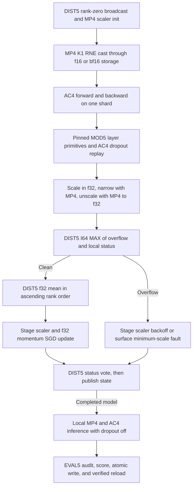

# Wave 4/5 composed trainer

The [v1 ABI](../include/eshkol_transformer/wave4_composed_trainer_abi.h) composes
MP4, AC4, MOD5, DIST5, and EVAL5 for bounded, native x86-64 CPU execution.
`et_wave4_composed_plan_v1` returns the exact scratch requirement and AC4
shape and memory counts. Each training process owns an equal-size microbatch
shard, scratch, and an f32 replica of the master weights and momentum.
`et_wave4_composed_bootstrap_v1` broadcasts rank zero's initial weights,
zeros momentum, and initializes the MP4 scaler using the agreed settings.



`et_wave4_composed_step_v1` dispatches MP4 through the real K1 runtime with a
single explicit provider. The cast uses verified rank-one tiles of 256, 64,
16, and 8 elements. AC4 consumes the widened parameter values and runs
causal attention, RMSNorm, and SwiGLU using its statically linked MOD5 provider.
AC4 owns dropout replay, keyed by its seed, step, and layer. The caller
supplies the attempted step and can use different seeds per rank.

The trainer scales AC4's f32 gradients, reuses the narrow buffer for the
scaled gradients, then unscales through MP4. A rejected narrow gradient cast
or an unscale overflow sets the local overflow flag. A rank with a validation
or upstream model failure participates in the same status vote, so peers
leave their persistent state untouched. On a clean vote, DIST5 synchronizes
the f32 gradients with an ascending-rank mean. Each rank stages
`momentum = beta * momentum + gradient` and
`master = master - learning_rate * momentum`, with binary32 arithmetic and
FP contraction disabled. A final status vote gates publication. On backoff
only the scaler changes. At minimum-scale underflow, weights, momentum,
scaler and the result record stay byte-for-byte unchanged.

`et_wave4_composed_evaluate_v1` runs the final widened parameters in AC4
forward-only mode with dropout disabled. It interprets the held-out
`[N,T,D]` output as `[N*T,D]` logits for fixture classes, audits the supplied
training and evaluation documents, and scores the supplied targets with
EVAL5. The caller provides dataset, tokenizer, and checkpoint identities. In
the fixture, the checkpoint hash is SHA-256 of the final f32 master bytes.
EVAL5 writes the canonical v1.0 manifest atomically and verifies its embedded
SHA-256 on reload. The trainer also compares the canonical reloaded bytes
with the intended manifest before returning it.

## Measured process matrix

The test forks one process per rank and connects peers with real Unix domain
stream sockets. Each lane uses `[N,T,Hq,Hkv,Dh] = [1,2,2,1,2]` per rank,
104 parameters per layer, and a dropout rate of 0.03125. Across both storage
formats and all world sizes, no-checkpoint and square-root checkpoint runs
match bit-for-bit on each rank's losses and on the master weights,
momentum, and scaler after each recorded attempt. Replicated state also
matches bit-for-bit across ranks. The held-out manifest checksums agree
between policies, and an altered manifest fails checksum verification.

Peak activation bytes are measured by AC4 in each live step. Total scratch
includes AC4's gradient staging, the widened weights and f32 gradients,
output and input-gradient buffers, and the reused narrow buffer. It does
not account for process memory, stack, K1 metadata, or DIST5 transport
allocations.

| Layers | Policy | Peak activation bytes | Total scratch bytes | Narrow parameter bytes | Equivalent f32 parameter bytes |
| ---: | --- | ---: | ---: | ---: | ---: |
| 4 | `NONE` | 1,472 | 7,360 | 832 | 1,664 |
| 4 | `SQRT_SEGMENTS` | 576 | 6,464 | 832 | 1,664 |
| 8 | `NONE` | 2,752 | 14,464 | 1,664 | 3,328 |
| 8 | `SQRT_SEGMENTS` | 640 | 12,352 | 1,664 | 3,328 |

The mean pre-update half-MSE across ranks is recorded below at binary64
round-trip precision. At attempt 2, only rank `W-1` receives an extreme
target and its finite gradient exceeds the narrow range. Every rank skips
the optimizer update and backs off from 64 to 32. The suite tries the fault
again at scale 32 and checks that every rank reports underflow with no
state change. The fault columns include the artificial target, while
loss decreases at every accepted attempt. The final column is the held-out
EVAL5 mean NLL after training.

| Layers | Ranks | Storage | 0 | 1 | 2 (overflow) | 3 | 4 | 5 | 6 | EVAL5 mean NLL |
| ---: | ---: | --- | ---: | ---: | ---: | ---: | ---: | ---: | ---: | ---: |
| 4 | 1 | f16 | 0.061464660713165808 | 0.059514780218936927 | 549755680732.35193 | 0.05320805401067133 | 0.044370408879145298 | 0.042392094062786004 | 0.040075074984576145 | 1.4275769073653362 |
| 4 | 2 | f16 | 0.060353348615308784 | 0.059193462999067505 | 274877842237.59589 | 0.052422695727756506 | 0.045646062671906601 | 0.042218854087666118 | 0.03893959860417217 | 1.4271671507889505 |
| 4 | 4 | f16 | 0.060461407618073656 | 0.057502954066385295 | 137438921950.78511 | 0.050524166630488004 | 0.045259980396674587 | 0.041029381570182252 | 0.037788037255892498 | 1.4260058878418294 |
| 4 | 1 | bf16 | 0.061479137379647678 | 0.059496674085851048 | 1.4870473904876968e+75 | 0.053182355451563121 | 0.044356920907795805 | 0.042423707978751848 | 0.040076524252024306 | 1.4275629870972706 |
| 4 | 2 | bf16 | 0.060367251434055864 | 0.059175684120535442 | 6.6834752525369673e+74 | 0.052441640119071251 | 0.045622604316461417 | 0.042243812899009636 | 0.038927970006167517 | 1.4272053284615787 |
| 4 | 4 | bf16 | 0.060470496204383509 | 0.057499342731877165 | 3.6256274095932966e+74 | 0.050509199832974416 | 0.045266669389294592 | 0.041056261525694124 | 0.037788661254567812 | 1.4259539565652783 |
| 8 | 1 | f16 | 0.05744014625854782 | 0.050427201408184949 | 549755780052.93298 | 0.038443127210496891 | 0.027421085690912245 | 0.021620205230704768 | 0.01540620565864816 | 1.4489854114338456 |
| 8 | 2 | f16 | 0.055886576420604378 | 0.05029873626326805 | 274877875142.8121 | 0.038409483133263124 | 0.028435504462279704 | 0.02199486202273197 | 0.016501394426279518 | 1.4485532355717887 |
| 8 | 4 | f16 | 0.056066656548007285 | 0.048488273558192144 | 137438937913.22572 | 0.03693247015851444 | 0.028123575994091952 | 0.02215877066439615 | 0.01597802518135457 | 1.4471768876557642 |
| 8 | 1 | bf16 | 0.057463303549506003 | 0.05040365695360885 | 6.2917258027465602e+74 | 0.038488128407831168 | 0.027423296205157852 | 0.021676711040947903 | 0.015428636704203306 | 1.4488765967096366 |
| 8 | 2 | bf16 | 0.055909678763193263 | 0.050311972141468556 | 3.89697314927073e+74 | 0.038462303002675433 | 0.028441489219354906 | 0.022058526482473587 | 0.016524256071494794 | 1.4484569869107804 |
| 8 | 4 | bf16 | 0.056084551026464521 | 0.048506776262395107 | 1.8801363065964696e+74 | 0.036897711759738813 | 0.028119859049571101 | 0.022220304041704525 | 0.016002821584950935 | 1.4471105995586089 |

## Verification and limits

Run these commands in `eshkol-r0-debug:20260928` with Clang 21 and the
worktree and Git metadata mounted at their existing paths.

```bash
CC=clang-21 CXX=clang++-21 WAVE4_COMPOSED_ASAN_DETECT_LEAKS=1 bash scripts/test-wave4-composed.sh
python3 -m unittest tests/q0/test_python_isolation.py
bash scripts/check-ci-topology.sh
```

The suite checks archive reproducibility and symbols, C++17 header
compatibility, native process parity, checkpoint memory, overflow,
underflow, and manifest integrity. It also exercises `EVERY_LAYER` and
`EVERY_K` in one-step parity tests, plus unsupported FP controls,
malformed configuration, capped activation memory, null and overlapping
spans, narrow weight range errors, a one-rank short workspace, and peer
disconnection. ASan, UBSan, and LeakSanitizer cover the composed trainer
and its native dependencies.

## Eshkol AOT compiled multi-process driver

The private AOT bridge ([wave4_composed_eshkol_bridge.h](../native/wave4_composed_eshkol_bridge.h),
[wave4_composed_eshkol_bridge.c](../native/wave4_composed_eshkol_bridge.c))
wraps `et_wave4_composed_plan_v1`, `et_wave4_composed_bootstrap_v1`,
`et_wave4_composed_step_v1`, and `et_wave4_composed_evaluate_v1` behind an
opaque handle over Unix-domain-socket DIST5 communicators. Each rank process
runs the compiled Eshkol AOT executable built from
[test_wave4_composed_aot.esk](../tests/wave4/test_wave4_composed_aot.esk)
(`--strict-types --optimize 0 --no-stdlib`) linked statically against
`libeshkol_transformer_wave4_composed_aot.a` and the foundation archives.

Two fresh compilations from clean cache and output directories produce
byte-identical ELFs and archives in `eshkol-r0-debug:20260928` with Clang 21:

- Bridge archive (`libeshkol_transformer_wave4_composed_aot.a`) SHA-256:
  `286154b7d33847f4c2daecd2034bbfd98846aa3dae53b4f39f77a5037d104252`
- Compiled Eshkol AOT ELF (`test_wave4_composed_aot`) SHA-256:
  `d9d3741932a9101fc10b6d9b3505bbc8bcf16228d6a144a83f7be768e8d0b791`

Across `L={4,8}`, `W={1,2}`, and `dtype={f16,bf16}`, independent compiled
rank processes execute bootstrap plus 7 training steps with single-rank narrow
overflow injection on rank `W-1` at step 2. Every lane verifies coordinated
`OVERFLOW_BACKOFF` (`64 -> 32`) across all ranks with bitwise-preserved master
weights, immediate `UNDERFLOW_FAULT` rejection at `min_scale=32` leaving
weights and scaler untouched, strictly decreasing recovery loss across steps
3–6, rank-0 EVAL5 manifest emission and SHA-256 reload verification
(`contaminated_documents = 0`), and bitwise-identical weight SHA-256,
manifest SHA-256, per-step losses, and `eval_nll` across ranks and between
`NONE` and `SQRT_SEGMENTS`:

- `L=4`: live activation peak `1,472 -> 576` bytes (`60.87%` reduction),
  workspace `7,360 -> 6,464` bytes.
- `L=8`: live activation peak `2,752 -> 640` bytes (`76.74%` reduction),
  workspace `14,464 -> 12,352` bytes.

| Layers | Ranks | Storage | Final weight SHA-256 | EVAL5 mean NLL | Mean loss trace (steps 0, 1, 2 [overflow], 3, 4, 5, 6) |
| ---: | ---: | --- | --- | ---: | --- |
| 4 | 1 | f16 | `854fc386b8649f973a6b7bc20f0bf1ea55d8690b39544bf2a9a25802cd6c27bd` | 1.4275769073653362 | `0.061464659860580556`, `0.059514779431172934`, `549755680732.35193`, `0.053208053211523276`, `0.04437040807492873`, `0.042392093233719647`, `0.040075074058767438` |
| 4 | 2 | f16 | `9affa31d6fe08f7f78683f5adc4815bdcb00741acd11e097c41b8bc245720718` | 1.4271686683453668 | `0.06035334773506891`, `0.05919346214499778`, `274877842237.59589`, `0.052422694912122876`, `0.045646061875262323`, `0.042218853307403263`, `0.03893959780312907` |
| 4 | 1 | bf16 | `9241b8c0d855bbcef94f0fb0d05a38ad3b0ecb350afb472d53b9c6dcaa492dbd` | 1.4275629870972706 | `0.0614791365266463`, `0.059496673299313629`, `1.4870473904876968e+75`, `0.053182354652998573`, `0.044356920104957148`, `0.042423707149617421`, `0.040076523326464511` |
| 4 | 2 | bf16 | `12313ed7351686ba1982c450cde64671ef51d9c289e13d8e48e22c794ef9c4f5` | 1.4272053284615787 | `0.060367250553481723`, `0.059175683265812448`, `6.6834752525369673e+74`, `0.052441639304347934`, `0.045622603519746424`, `0.04224381211830034`, `0.038927969205054674` |
| 8 | 1 | f16 | `f3b5d3640d91a800ba65485a7326349c9d3c9375ffa7a0a1277d66bdf5693ea7` | 1.4489854114338456 | `0.057440145605941476`, `0.050427200880254555`, `549755780052.93298`, `0.038443126741356096`, `0.027421085268270518`, `0.021620204872330812`, `0.0154062052788916` |
| 8 | 2 | f16 | `5f3a7fdaa9ddd36511e7e8842e66100837f7f77901dfdd28d2f2a84363d1f02c` | 1.4485532355717887 | `0.055886575691219582`, `0.05029873557863776`, `274877875142.8121`, `0.038409482488425836`, `0.028435498062177128`, `0.021994861447981906`, `0.016501393860730733` |
| 8 | 1 | bf16 | `d8498dc4303d4874d2ac967339544a89554bf2515c23881f821fa2929c22f402` | 1.4488765967096366 | `0.05746330289641402`, `0.050403656425521456`, `6.2917258027465602e+74`, `0.03848812793719289`, `0.027423295784909377`, `0.02167671068428079`, `0.015428636324414689` |
| 8 | 2 | bf16 | `90596638a12e9e118061bbd804273eabfadf2f7cefa103829a1925ae820ee7f8` | 1.4484569869107804 | `0.055909678033456478`, `0.050311971457582927`, `3.89697314927073e+74`, `0.038462302357515618`, `0.028441488595837637`, `0.022058525906262637`, `0.016524255505990182` |

Run the Eshkol AOT verification suite in `eshkol-r0-debug:20260928`:

```bash
CC=clang-21 CXX=clang++-21 ESHKOL_SOURCE_DIR=/tc/src ESHKOL_BUILD_DIR=/tc/build \
  bash scripts/test-wave4-composed-aot.sh
```

Note: `sock_dir` for `world > 1` must keep `<sock_dir>/rank0.sock` within
Linux's 108-byte `AF_UNIX` `sun_path` limit; oversized paths are rejected
explicitly with `ET_WAVE4_COMPOSED_INVALID_ARGUMENT`.

Composition supports L=4 and L=8 for AC4's reviewed CPU shapes. The
measured matrix covers the single short MQA shape and W=1, 2, and 4. Ranks
must use an agreed configuration and synchronized call order. MP4
conversions are real narrow storage, with f32 model compute and optimizer
state. Evaluation covers one fixture sequence and one byte document per
split. Model persistence, resuming after transport failure, multi-host
execution, GPU and narrow compute, language-model quality, and throughput
are outside this verification. A transport or protocol failure requires
discarding the communicator and distributed state. DIST5's final fan-out
can fail after a peer received a commit, so the caller must recover from
an agreed prior state before resuming.
